<picture>
  <source media="(prefers-color-scheme: dark)" srcset="assets/console-dark.svg">
  
</picture>

  <a href="https://volodymyr-pivtoranis.vercel.app"><b>portfolio</b></a> ·
  <a href="https://github.com/PivtoranisV/chess-game"><b>play my terminal chess</b></a> ·
  <a href="https://github.com/PivtoranisV/rails-react"><b>rails + react</b></a>

The card above is drawn by <a href="src/render.rb">a stdlib-only Ruby script</a> and refreshed daily by GitHub Actions. No external services involved. Each ♟ square on the board is one day of commits.
